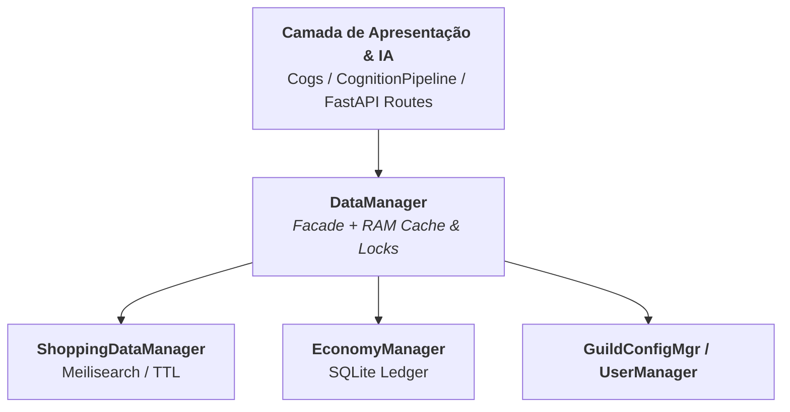

# ⚙️ Engenharia Interna & Persistência

Este documento mergulha nos pilares estruturais da **SamBot**, detalhando como o projeto isola a persistência de dados através do padrão **Facade**, divide responsabilidades de domínio via **SubManagers**, garante a integridade e performance contínua com o ciclo autônomo (**NightCycle**) e assegura a rastreabilidade completa do sistema por meio de **Auditoria Estruturada**.

## 1. Padrão Facade: Centralização e Segurança de Dados

Na arquitetura da SamBot, o **`DataManager`** atua como uma **Fachada Unificada (Facade)** entre a camada de apresentação/cognição (`Cogs`, `CognitionPipeline`, rotas `FastAPI`) e os diferentes motores de armazenamento. Seu propósito não é concentrar regras de negócio em um arquivo monolítico, mas oferecer uma interface única, segura contra concorrência e independente de backend.



### 1.1. Benefícios Estruturais

- **Desacoplamento Total:** Um módulo (como `Shopping.py` ou `Agent.py`) não precisa saber se a informação reside em um banco relacional SQLite, no motor de busca Meilisearch ou em arquivos JSON protegidos. Ele apenas invoca o método correspondente na fachada.

- **Proteção de Concorrência (Thread & Async Safety):** Operações de leitura e escrita em disco (especialmente em arquivos `.json` dentro de `Data/Persistence/`) são protegidas por cache em RAM e travas de exclusão mútua (`threading.Lock` / `asyncio.Lock`), eliminando _race conditions_ e corrupção de arquivos durante picos simultâneos de mensagens.

- **Testabilidade e Mocks:** Permite validar submanagers isoladamente injetando bancos em memória, sem necessidade de subir a instância completa do Discord Gateway.

## 2. Segregação de Domínios via SubManagers

Cada SubManager governa uma fatia específica do ecossistema, selecionando o motor de persistência ideal para o seu perfil de carga:

### 2.1. `ShoppingDataManager`

- **Motor:** Meilisearch (`/indexes/ofertas`).
- **Responsabilidade:** Indexação _full-text_ de promoções raspadas do Telegram e scrapers web, ordenação dinâmica por menor preço, filtragem por categorias e controle rigoroso de expiração temporal (TTL).
- **Operações Críticas:**
  - `search_cached_offers(query, limit, max_price)`: Executa consultas instantâneas filtrando apenas registros válidos (`expira_em > agora AND ativo = true`).
  - `save_offers(offers)`: Ingestão assíncrona em lote com normalização de metadados e preços.
  - `purge_expired_offers(now_ts)`: Limpeza em massa de promoções vencidas para manter o índice enxuto.

### 2.2. `EconomyManager`

- **Motor:** SQLite Relacional (`database.db`) e registros de mercado em `Data/Knowledge/`.

- **Responsabilidade:** Gestão de saldos, recompensas diárias (`daily`), histórico de transações, flutuações de mercado fictício e integridade financeira.

- **Operações Críticas:**
  - `get_balance(user_id)`: Recupera saldos consolidados de carteira e conta bancária.
  - `transfer_funds(source_id, target_id, amount)`: Executa movimentações sob transações **ACID** (`aiosqlite`), garantindo que débitos e créditos ocorram de forma atômica ou sofram _rollback_ imediato em caso de falha.

### 2.3. `GuildConfigManager` & `KnowledgeManager`

- **Motor:** SQLite Relacional + Arquivos Estáticos (`Data/Knowledge/` e `Data/Persistence/identity.json`).

- **Responsabilidade:** Armazenamento de prefixos customizados por servidor (`BOT_PREFIX`), canais de alertas (como notificações do Jellyfin), permissões de módulos e sincronização da base de conhecimento e identidade da IA.

## 3. Ciclo Noturno de Manutenção (`NightCycle`)

O **`NightCycle`** é o processo autônomo de manutenção e "sono" cognitivo da SamBot. Agendado para janelas de baixa atividade (padrão: `04:00 AM UTC`), ele evita a degradação progressiva de performance causada pelo acúmulo de dados brutos, logs e fragmentação de índices.

```text
[ Agendador Assíncrono (04:00 AM UTC) ]
                  │
                  ├─► 1. Higiene de Ofertas (Meilisearch)
                  │      └─► Expurga documentos com expira_em <= now()
                  │
                  ├─► 2. Otimização Relacional (SQLite)
                  │      ├─► PRAGMA optimize
                  │      ├─► PRAGMA wal_checkpoint(TRUNCATE)
                  │      └─► VACUUM (desfragmentação do database.db)
                  │
                  ├─► 3. Consolidação Cognitiva & RAG (ChromaDB)
                  │      ├─► Sumariza registros brutos diários
                  │      └─► Valida integridade dos índices vetoriais HNSW (VectorDB)
                  │
                  └─► 4. Economia Fictícia & Buffers
                         ├─► Recalcula flutuações do mercado virtual do servidor
                         └─► Limpa sessões expiradas e libera memória RAM

```

### 3.1. Pipeline de Execução do `NightCycle`

```python
async def run_night_cycle(self) -> None:
    now_ts = int(time.time())
    self.logger.info("Iniciando rotina do NightCycle (timestamp=%d)...", now_ts)

    # 1. Expurgo de ofertas expiradas no Meilisearch
    purged_count = await self.shopping_data_manager.purge_expired_offers(now_ts)
    self.logger.info("NightCycle: %d ofertas expiradas removidas.", purged_count)

    # 2. Consolidação e otimização do SQLite (WAL Mode)
    async with self.db_connection() as db:
        await db.execute("PRAGMA optimize;")
        await db.execute("PRAGMA wal_checkpoint(TRUNCATE);")
    self.logger.info("NightCycle: SQLite WAL consolidado e otimizado.")

    # 3. Consolidação de memórias RAG e recálculo de mercado
    await self.memory_manager.consolidate_daily_memories()
    await self.economy_manager.recalculate_market_fluctuations()

    # 4. Limpeza de sessões temporárias e cache
    await self.cleanup_stale_sessions()

```

## 4. Auditoria de Logs e Rastreabilidade

O subsistema de observabilidade foi projetado para registrar eventos críticos e diagnósticos sem bloquear o _event loop_ assíncrono (`asyncio`).

### 4.1. Arquitetura de Logging e Saídas

1. **Formatação Estruturada:** Cada entrada registra carimbo de data/hora, severidade (`DEBUG`, `INFO`, `WARNING`, `ERROR`, `CRITICAL`), módulo emissor e mensagem higienizada.
2. **Roteamento Multi-Handler (`logs/`):**

- **Console (`StreamHandler`):** Saída com codificação de cores ANSI direcionada para `sys.stdout`, facilitando o monitoramento em tempo real via `docker compose logs -f sambot`.

- **Logs Gerais (`sambot_general.log`):** Rotação automática por tamanho (`RotatingFileHandler`, limite de 10 MB e retenção de 5 backups) registrando o fluxo operacional do sistema.

- **Logs de Erro (`sambot_errors.log`):** Arquivo dedicado exclusivamente a exceções (`ERROR` e `CRITICAL`) e falhas de provedores externos, agilizando a triagem de incidentes.

- **Trilha de Auditoria (`audit.log` / Tabela SQLite):** Registra ações administrativas sensíveis (alterações de permissões, comandos de moderação, ajustes manuais de saldo pelo `OWNER_ID` e purgas de banco).

### 4.2. Diretrizes de Código e Segurança para Contribuidores

- **Proibição de `print()`:** Todo output operacional deve passar pelo `Logger` central do projeto (`self.logger.info`, `warning`, `error`).

- **Preservação de Stack Trace:** Em blocos `try/except`, utilize sempre `self.logger.exception("Contexto da falha")` para gravar o rastreamento completo em `sambot_errors.log`.

- **Acesso Exclusivo via Facade:** Nunca utilize `open()` nativo para ler ou gravar diretamente nos arquivos JSON dentro de `Data/Persistence/`. Utilize sempre os métodos do `DataManager` para respeitar as travas de concorrência (`threading.Lock`).

- **Sanitização de Segredos (Zero-Leak):** Nunca registre tokens (`DISCORD_TOKEN`, `API_SECRET_TOKEN`), chaves de IA (`GEMINI_API_KEY`, `GROQ_API_KEY`), senhas do Navidrome ou cabeçalhos `Authorization` nos arquivos de log nem no banco vetorial `VectorDB`.
