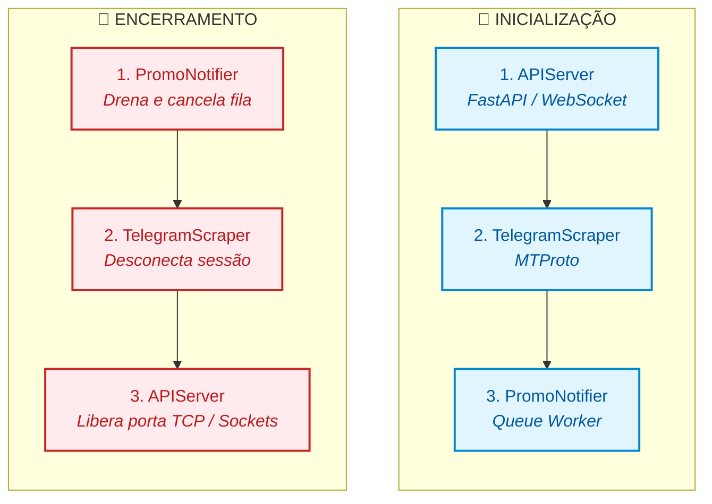

# 🎛️ ServiceManager

O **`ServiceManager`** é o orquestrador central de serviços em segundo plano da **SamBot**. Ele atua como um _Supervisor_ acoplado à instância principal do bot (`bot.services`), gerenciando o carregamento resiliente, as chaves de ativação (`Feature Flags`), a ordem determinística de inicialização e o encerramento gracioso (_graceful shutdown_) de todos os subsistemas autônomos.

## 🏗️ 1. Arquitetura e Chaves Seletoras

Para permitir que a SamBot opere tanto em ambientes enxutos (apenas Discord) quanto em topologias completas (com painel web, scraping de ofertas e webhooks), o `ServiceManager` implementa um **controle hierárquico de ativação** lido via `config.yaml`:

```yaml
services:
  enabled: true # Chave Mestra (Master Switch)
  api: true # Servidor FastAPI + WebSockets (APIServer)
  telegram: false # Ingestor MTProto Telethon (TelegramScraper)
  notifier: false # Fila de Notificações e Webhooks (PromoNotifier)
```

### 1.1. Mecanismos de Resiliência no Boot

- **Importação Protegida (_Fault-Tolerant Imports_):** Caso alguma dependência opcional de um serviço esteja ausente ou falhe na importação (ex: `telethon` ou `uvicorn`), o `ServiceManager` captura a exceção, registra um aviso no log e isola a falha (`None`), impedindo que o bot principal deixe de inicializar.
- **Master Switch (`services.enabled`):** Se definido como `false`, anula imediatamente a instanciação de todos os serviços filhos e ignora qualquer chamada posterior de `start_all()`, `stop_all()` ou `restart_all()`.
- **Execução Encapsulada (`_safe_start` / `_safe_stop`):** Cada serviço é iniciado e encerrado dentro de blocos protegidos com registro completo de _stack trace_ (`exc_info=True`), garantindo que o travamento de um serviço não interrompa o ciclo dos demais.

## 🔄 2. Ciclo de Vida Determinístico (`start`, `stop` e `restart`)

O `ServiceManager` impõe uma **ordem estrita de dependência** durante a subida e a queda da aplicação, espelhando o padrão de pilha (_LIFO — Last-In, First-Out_):



- **Por que essa ordem?** O `APIServer` sobe primeiro para expor as rotas de controle, telemetria e WebSockets antes que o `TelegramScraper` comece a captar ofertas e o `PromoNotifier` passe a despachar alertas. No encerramento, a ordem se inverte para interromper produtores e consumidores de fila antes de fechar o servidor HTTP.
- **Reinicialização a Quente (`restart_all()`):** Executa `stop_all()`, aguarda uma janela de **1.0 segundo** (`asyncio.sleep(1.0)`) para o sistema operacional liberar portas TCP e sockets pendentes, e reinicia toda a stack.

## 🧩 3. Os Microsserviços Gerenciados

### 3.1. `APIServer` (`Services/API/Server.py`)

Servidor web assíncrono baseado em **FastAPI** e **Uvicorn**, responsável por conectar a SamBot ao painel administrativo web (WebUI) e a integrações externas.

- **Segurança & Autenticação (`Security.py`):**
  - Protege endpoints sensíveis exigindo o cabeçalho `X-Bot-Token` validado contra `api.secret_token` / `API_SECRET_TOKEN`.
  - Implementa trava **Anti-Path Traversal** no `FileService` para edição segura de arquivos de configuração e _Hot-Reload_ de rotas semânticas (`TLMRouter`) e banco SQLite (`DatabaseSeeder`).
  - Realiza autenticação **Discord OAuth2** (`/api/auth/discord/exchange` e `/session`), cruzando em tempo real o ID do usuário logado com os canais de voz ativos do bot.

- **Comunicação em Tempo Real (`/ws/bot` & `/api/v1/logs/ws`):**
  - **`GuildConnectionManager`:** Gerencia salas WebSocket isoladas por servidor (`guildId`), transmitindo atualizações de estado do player de áudio apenas para clientes conectados àquela guilda.
  - **Player Remoto & Anti-Ghost DJ:** Recebe comandos (`PLAY`, `ENQUEUE`, `SEEK`, `SET_VOLUME`, `REORDER_QUEUE`, etc.) e valida se o usuário solicitante está fisicamente presente no mesmo canal de voz da SamBot antes de executar a ação no Lavalink.
  - **Streaming de Logs:** Faz _tail_ assíncrono em tempo real dos arquivos `sambot_general.log` e `sambot_errors.log` via WebSocket.

- **Rotas REST Modulares (`Services/API/Routes/`):**
  - `/api/control/*`: Matriz de latência (`ping-matrix` medindo Discord, Internet e Navidrome), status de hardware (`psutil`) e controle REST do player.
  - `/api/v1/db/*`: Inspetor visual de tabelas SQLite, estatísticas do Meilisearch e testes de similaridade vetorial no ChromaDB.
  - `/api/download/*`: Despacha tarefas de extração de áudio para o worker externo (`YT_WORKER_URL`) e monitora o progresso em segundo plano.
  - `/api/v1/jellyfin/webhook`: Recebe eventos `ItemAdded` do Jellyfin, atualiza o catálogo local/vetorial e publica cards no Discord.

### 3.2. `TelegramScraper` (`Services/Telegram/`)

Cliente de usuário MTProto baseado em **Telethon** que monitora canais e grupos de promoções do Telegram em tempo real.

- **Gestão Dinâmica de Canais:** Combina os canais estáticos configurados em `TELEGRAM_CHANNELS` com os grupos cadastrados dinamicamente na base `monitored_telegram_channels` (via comando `+colaborar promo`), permitindo atualizar a lista de escuta em tempo real (`atualizar_canais_escutados()`) sem reiniciar o bot.
- **Autenticação Interativa via Discord DM:** Se a sessão `.session` estiver ausente ou expirada no boot, o serviço não trava o bot: ele dispara uma task em segundo plano que conduz o fluxo de login (telefone, código SMS/App e senha 2FA) diretamente via Mensagem Direta com o `OWNER_ID` (ou colaborador) e apaga automaticamente as mensagens sensíveis após 20 segundos.
- **Filtro de Pré-Ingestão:** Descarta mensagens irrelevantes antes do parsing pesado, processando apenas textos que contenham URLs (`http`) ou indicadores de preço (`R$`).

### 3.3. `PromoNotifier` (`Services/Notifications/`)

Motor assíncrono desacoplado de fila (`asyncio.Queue`) dedicado à entrega de alertas de ofertas e eventos externos.

- **Processamento Assíncrono (`_process_queue`):** Desacopla a captação de ofertas do envio no Discord, evitando bloqueios por _Rate Limit_ da API do Discord através de espaçamento controlado (`asyncio.sleep(0.5)` em disparos globais).
- **Roteamento Multi-Destino (`target_type`):**
  - `server`: Envia o Embed formatado da oferta para um canal específico.
  - `dm`: Envia alerta privado para um usuário (ex: alertas de preço alvo do `PriceTracker`), tratando graciosamente casos de DMs bloqueadas (`discord.Forbidden`).
  - `all`: Distribui a oferta para todos os canais cadastrados em `active_channels`.

- **Disparo de Webhooks Externos (`WebhookDispatcher`):** Após processar o envio no Discord, propaga o evento `promo_alert` (via `HTTP POST` assíncrono com cabeçalho `X-Event-Type` e `Bearer Token` opcional) para todos os webhooks externos inscritos naquela guilda ou globalmente.
